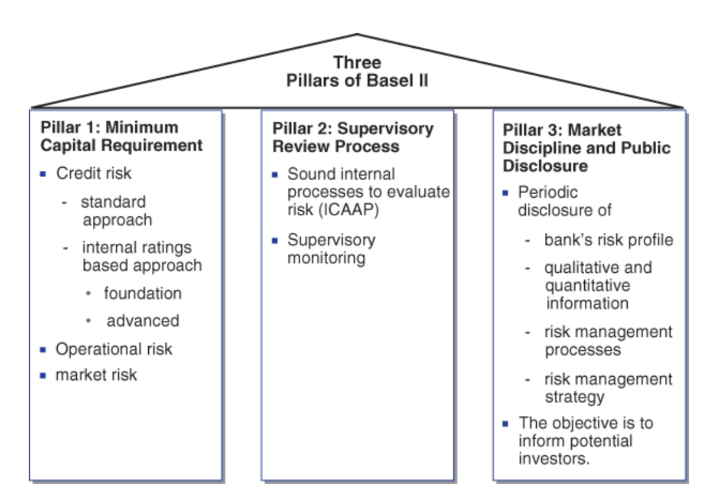
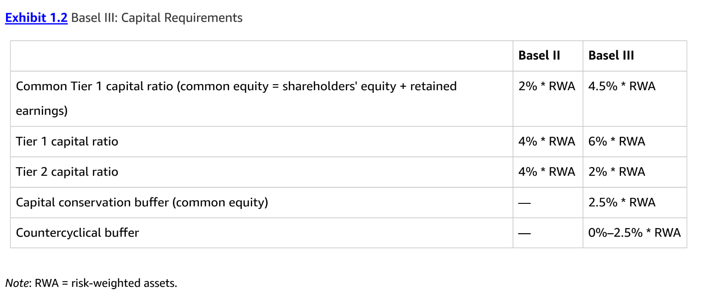
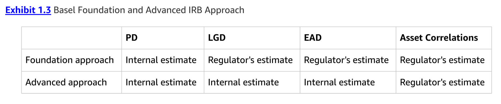
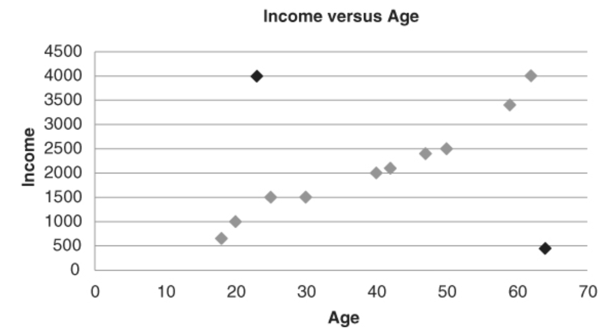

# Notes

## Chapter 1: Introduction to Credit Risk Analytics
Regulatory capital is then the amount of capital a bank should have according to a regulation.

Economic capital is the required equity capital which is calculated by their own risk modeling strategy and policy.

The actual capital is then the amount of capital a bank actually holds and is the higher of the economic capital and the regulatory capital.

Note that various types of capital exist, depending upon their loss-absorbing capacity.
- Tier 1 capital typically consists of common stock, preferred stock, and retained earnings.
- Tier 2 capital is of somewhat less quality and is made up of subordinated loans, revaluation reserves, undisclosed reserves, and general provisions.

### Basel I

Important drawbacks of Basel I:
1. The solvency of the debtor was not properly taken into account since the risk weights depended only on the exposure class and not on the obligor or product characteristics. 
2. There was insufficient recognition of collateral guarantees to mitigate credit risk.
3. It offered various opportunities for regulatory arbitrage by making optimal use of loopholes in the regulation to minimize capital. 
4. It considered only credit risk, not operational or market risk.

### Basel II
Basel II Capital Accord consists of three key pillars:
- Pillar 1 covers the minimal capital requirements,
- Pillar 2 is about the supervisory review process, and
- PIllar 3 is market discipline and disclosure.

The Basel II Capital Accord foresees three ways to model credit risk:
- the standard approach,
- the foundation internal ratings based approach, and
- the advanced internal ratings based approach.

All quantitative models built under Pillar 1 need to be reviewed by overseeing supervisors.

Key activities to be undertaken in Pillar 2 are the introduction of sound processes to evaluate risk, such as the internal capital adequacy assessment process (ICAAP) and supervisory monitoring.

Finally, once all quantitative risk models have been approved, they can be disclosed to the market. This is covered by Pillar 3.

### Basel III

### Basel Approaches to Credit Risk Modeling
Basically, there are three approaches available:
- the standardized approach,
- the foundation internal ratings based approach,
- the advanced internal ratings based approach.

The approaches differ in terms of their sophistication and level of flexibility related to using internally estimated risk numbers.

#### Standardized Approach
Although the standardized approach looks simple and appealing at first sight, it suffers from inconsistencies between ratings of different ECAIs with the accompanying danger of banks' cherry-picking the ECAIs. It also has problems in terms of coverage of various types of exposures. 

#### Internal Ratings Based (IRB) Approach
The IRB approach is a more sophisticated approach for quantifying credit risk. It relies on four key risk parameters:
- PD
- EAD
- LGD
- EL ($EL = PD \times EAD \times LGD$)

Basically, there are two subapproaches of the IRB approach:
- the foundation IRB approach
- the advanced IRB appraoch.

In the foundation IRB approach, the PD is estimated internally by the bank, while the LGD and EAD are either prescribed in the Basel Accord or provided by the local regulator. 

In the advanced IRB approach, all three risk parameters, PD, LGD, and EAD, can be estimated internally by the bank itself. Furthermore, regulators provide asset correlations, which measure the degree to which the asset values underlying the credit exposures are correlated. In this setting, the asset correlations are either constant or a monotone function that is declining with increasing PDs.

A distinction is made between the following types of exposure classes:
- corporate,
- retail,
- central governments (sovereigns) and central banks,
- institutions,
- equity exposures,
- securitization positions, and
- other non-credit-obligation assets.

The F-IRB approach is not permitted for retail exposures. Hence, for retail exposures, you can choose either the standard or the A-IRB approach.

Once the PD, LGD, and EAD are known, risk weight functions provided in the Basel Accord or directive can be used to caluclate the regulatory capital.

In essence, capital is set to equal unexpected losses (ULs).

$$\text{Unexpected Losses} = \text{Credit Value-at-Risk} - \text{Expected Losses}$$

Expected losses are provisioned for, and provisions are losses in the P&L statement and hence already netted with the equity account. As a result, the capital of a bank should cover losses that exceed provisions, and these losses are called unexpected losses.

The credit value at risk (VaR) is computed in a similar way as expected losses, with the distinction that PD, LGD, and EAD are stressed to reflect an economic downturn:
- PD is stressed via the concept of a worst-case default rate given a virtual macroeconomic shock based on a confidence level of 99.9 percent and a sensitivity to the macroeconomy that is based on the asset correlation.
- LGD is based on an economic downturn.
- EAD is based on an economic downturn.

---

## Chapter 4: Data Preprocessing for Credit Risk Modeling
### Data sources
Different types of data sources:
- __Transaction data__: detailed information capturing the key characteristics of a customer transaction
- __Contractual, subscription, or account data__: includes information about the type of product (e.g., loan) combined with customer characteristics.
- __sociodemographic information__: age, gender, marital status, income level, education level, occupation, and religion.
- __Surveys__: they may aim at gathering sociodemographic data, but also behavioral information.
- __Behavioral information__: concerns any information describing the behavior of an individual or an entity in the particular context under study.
- __Unstructured data__ embedded in text documents or multimedia content can be interesting to analyze. However they require extensive preprocessing.
- __Qualitative, expert-based data__: a popular example of applyi9ng expert-based validation is checking the univariate signs of a regression model.
- __Publicly available__ data sources. Examples: macroeconomic data, 

### Sampling
_Sampling bias_ should be avoided as much as possible. 

### Data elements
The following types of data elements can be considered:
- __Continuous data__ e.g, loan-to-value (LTV) ratio; income; balance on checking/savings 
- __Categorical data__
    - __Nominal__ e.g., payment type, industry sector
    - __Ordinal__ e.g., credit rating, age coded as young, middle-aged, or old
    - __Binary__ e.g., default (yes/no); employed (yes/no)

### Descriptive Statistics: Missing Values
Missing values can occur for various reasons:
- The information can be nonapplicable
- The information can be undisclosed
- An error during merging

Some analytical rechniques (e.g., decision trees) can deal directly with missing values. Other techniques need some additional preprocessing. The following are the most popular schemes that deal with missing values:
- __Replace (impute)__. This implies replacing the missing value with a known value.
- __Delete__. This method assumes that information is missing at random and has no meaningful interpretation and/or relationship to the target.
- __Keep__. Missing values can be meaningful.

As a practical way of working, you can first start by statistically testing whether missing information is related to the target variable (using, e.g., a chi-square test). If yes, then you can adopt the keep strategy and make a special category for it. If not, depending on the number of observations available, you can decide to either delete or impute.

### Descriptive Statistics: Outlier Detection and Treatment
Two types of outliers:
1. Valid observations (e.g., salary of boss is $1 million)
2. Invalid observations (e.g., age is 300 years)
Both are univariate outliers in the sense that they are outlying on one dimension. However, outliers can be hidden in unidimensional views of the data. Multivariate outliers are observations that are outlying in multiple dimensions.

Two important steps in dealing with outliers are detection and treatment. A first obvious check for outliers is to calculate the minimum and maximum values for each of the data elements. Various graphical tools can be used to detect outliers.
- Histograms,
- Boxplots

A practical rule of thumb then defines outliers when the absolute value of the z-score is bigger than 3. Note that the z-score method relies on the normal distribution.

Multivariate outliers can be detected by fitting regression lines and inspecting the observations with large errors (e.g., using a residual plot). Alternative methods are clustering or calculating the Mahalanobis distance. Note, however, that although potentially useful, multivariate outlier detection is typically not considered in many modeling exercises due to the typically marginal impact on model performance. 

Some analytical techniuques (e.g., decisin trees, neural networkds, support vector machines) are failry robust with respect to outliers. Others (e.g., linear/logistic regression) are more sensitive to them...

### Standardizing Data
Standardizing data is a data preprocessing activity targeted at scaling variables to a similar range.
